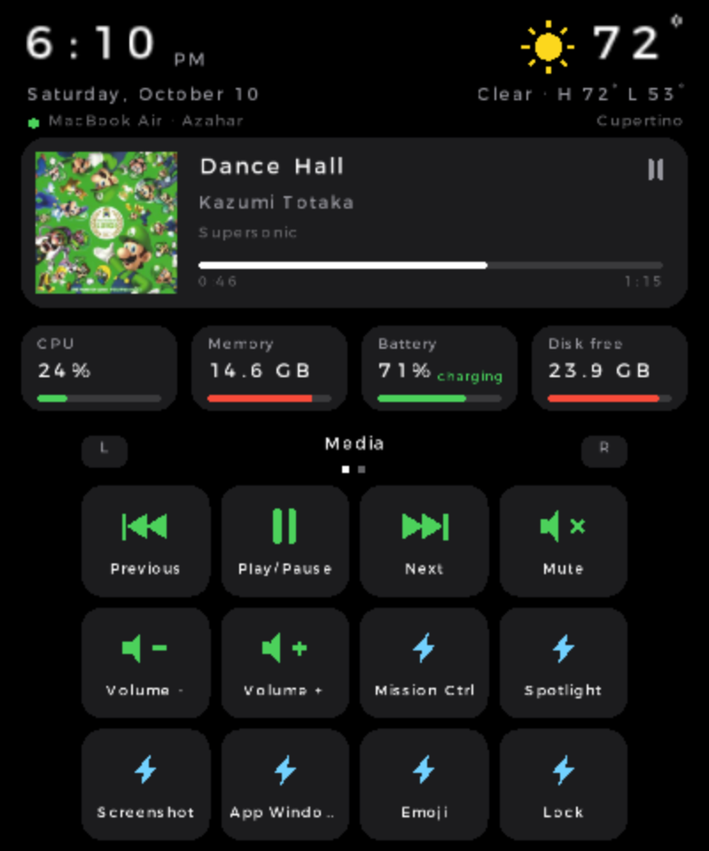
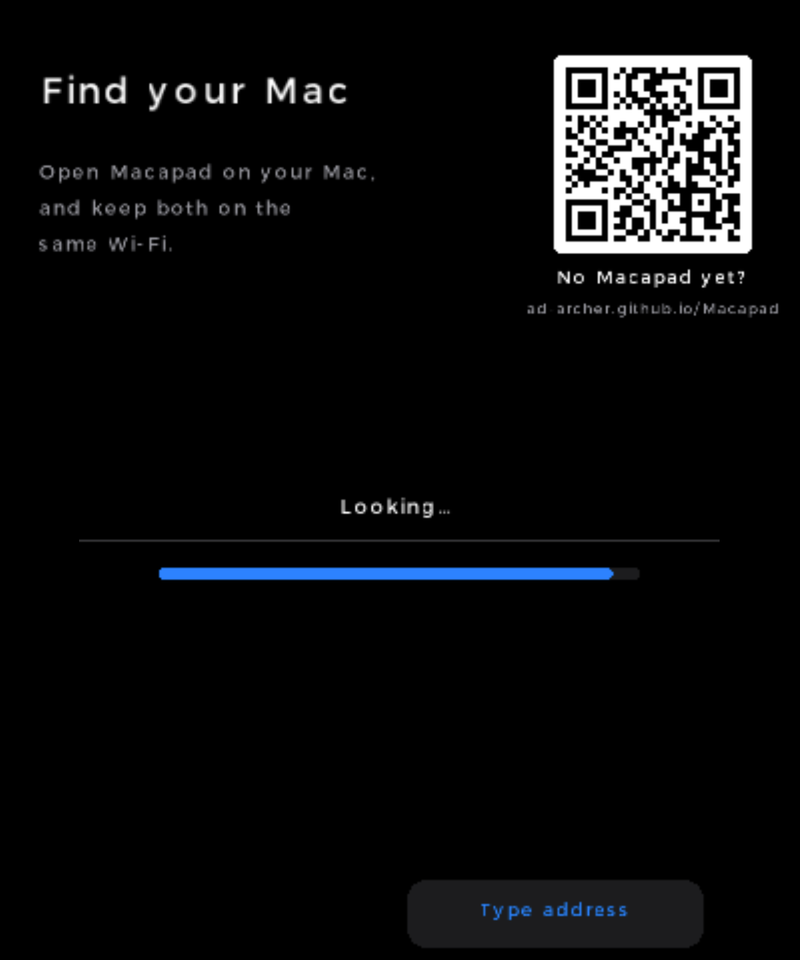
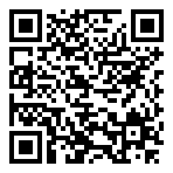

# Macapad for 3DS

A [Macapad](https://github.com/ad-archer/macapad) frontend for the Nintendo 3DS.

- **Top screen:** the time (from the Mac's clock), the weather where the Mac is, what's playing on the Mac (any app) with artwork and progress, and
  CPU, memory, battery and disk.
- **Bottom screen:** a 4×3 pad of keys, in pages. A key can run a Mac action, open an app (with its icon), open a
  website, press a keyboard shortcut or run a Shortcut.

| Dashboard and keys | Finding your Mac |
|---|---|
|  |  |

Screenshots are from the Azahar emulator, whose stand-in font spaces letters widely; a real 3DS draws them normally.

Needs Macapad with `GET /api/status` (0.4+), on the same Wi-Fi as the 3DS. A 3DS can't join a tailnet.

**Don't have Macapad on your Mac yet?** Get it at **[ad-archer.github.io/Macapad](https://ad-archer.github.io/Macapad/)**.
The 3DS's "Find your Mac" screen shows a QR code for that page too.

## Install with FBI

In FBI on the 3DS, choose **Remote Install → Scan QR Code** and scan this. It always installs the newest build
(`releases/latest/download/macapad.cia`), so scan it again to update.

The repository has to be public for this: FBI downloads without signing in to GitHub.

## Build and run

Uses devkitPro's Docker image, so the only thing to install is Docker Desktop (keep it running). `just` lists the tasks:

| Command | Does |
|---|---|
| `just build` | builds `macapad.3dsx` (always clean: the Docker VM's clock drifts, so make's timestamps can't be trusted) |
| `just run` | builds and opens it in the Azahar emulator |
| `just send 10.0.0.42` | builds and sends it to the 3DS over Wi-Fi: open the Homebrew Launcher and press **Y** first |
| `just sd /Volumes/NINTENDO` | builds, copies it to `3ds/` on a mounted SD card and ejects it |
| `just cia` | builds `macapad.cia`, which installs to the HOME Menu with FBI |
| `just clean` | removes build output |

On the 3DS, open it from the Homebrew Launcher, or install the CIA with FBI to get a HOME Menu icon.

### GitHub Actions

`.github/workflows/build.yml` builds both on every push and pull request (they're in each run's **Artifacts**).
Pushes to `main` also replace the **Latest build** release (tag `continuous`). A tag like `v1.0.0` makes a versioned
release instead, with the tag as the CIA's version. Whichever is newest is GitHub's "latest" release, which is what
the QR code points at; each release also carries the QR code as `macapad-qr.png`.

`cia/` holds what the CIA needs on top of the 3DSX build: `macapad.rsf` (title id `000400000F731700` and the
services it may use), the HOME Menu banner (`banner.png`, 256×128, and its sound, `Single-Click.wav`) and `build-cia.sh`, which
fetches pinned makerom and bannertool builds and packs `macapad.elf` + `macapad.smdh`.

## Using it

1. **Find your Mac.** It knocks on port 7317 of every address on your Wi-Fi and lists the Macs that answer. If yours
   doesn't show, tap **Type address** and enter its IP (`192.168.1.20`, or `192.168.1.20:7399` for another port).
2. **Pair.** Your Mac shows an Allow / Don't Allow panel with a 4-digit code; check it matches the 3DS and click
   Allow. The 3DS shows up in Macapad's Settings as "<console name>'s 3DS".
3. **Press keys.** Tap a key to run it. Tap an empty slot, or hold any key, to change it.

| Button | Does |
|---|---|
| L / R | previous / next page |
| X | play / pause |
| D-pad ← → | previous / next track |
| D-pad ↑ ↓ | volume |
| Y | mute |
| SELECT | edit mode (tap any key to change it) |
| START | menu: edit keys, add / rename / remove pages, 12/24-hour clock, forget this Mac, quit |

If the Mac's address changes, the 3DS looks for the same Mac on the network again after a few failed polls.

## Files on the SD card

`sd:/3ds/macapad/`:

- `config.json`: the Mac's address, this 3DS's device token, clock setting
- `pads.json`: your pages and keys. Each key is `{kind, label, ref, category?}`, where `kind` is `action`, `app`,
  `web`, `keys` or `shortcut` and `ref` is the action id, bundle id, URL, key combo (`cmd+shift+t`) or Shortcut name.
- `icons/<bundleId>.png`: app icons, cached

## Code

| File | What |
|---|---|
| `source/main.c` | screens: find, pair, dashboard + pad, key editor, lists, menu |
| `source/macapad.c` | config and pads on the SD card, status / press / icon threads, scanning, pairing, catalog |
| `source/http.c` | a small HTTP/1.1 client on the 3DS socket API, plus the subnet scan |
| `source/gfx.c` | rounded rects, circles as triangle fans, text that fits, media glyphs, PNG → texture |

Circles are drawn as triangle fans rather than with citro2d's ellipse calls, which Azahar doesn't draw.

## Emulator

[Azahar](https://github.com/azahar-emu/azahar) runs it (`Azahar.app/Contents/MacOS/azahar macapad.3dsx`), and its
network calls reach the Mac's localhost. Its replacement system font spaces letters widely; a real 3DS looks normal.

## License

Copyright (C) 2026 Antonio Archer

This program is free software: you can redistribute it and/or modify it under the terms of the GNU General Public
License as published by the Free Software Foundation, either version 3 of the License, or (at your option) any later
version. It is distributed in the hope that it will be useful, but WITHOUT ANY WARRANTY; without even the implied
warranty of MERCHANTABILITY or FITNESS FOR A PARTICULAR PURPOSE. See [LICENSE](LICENSE) for the full text.
